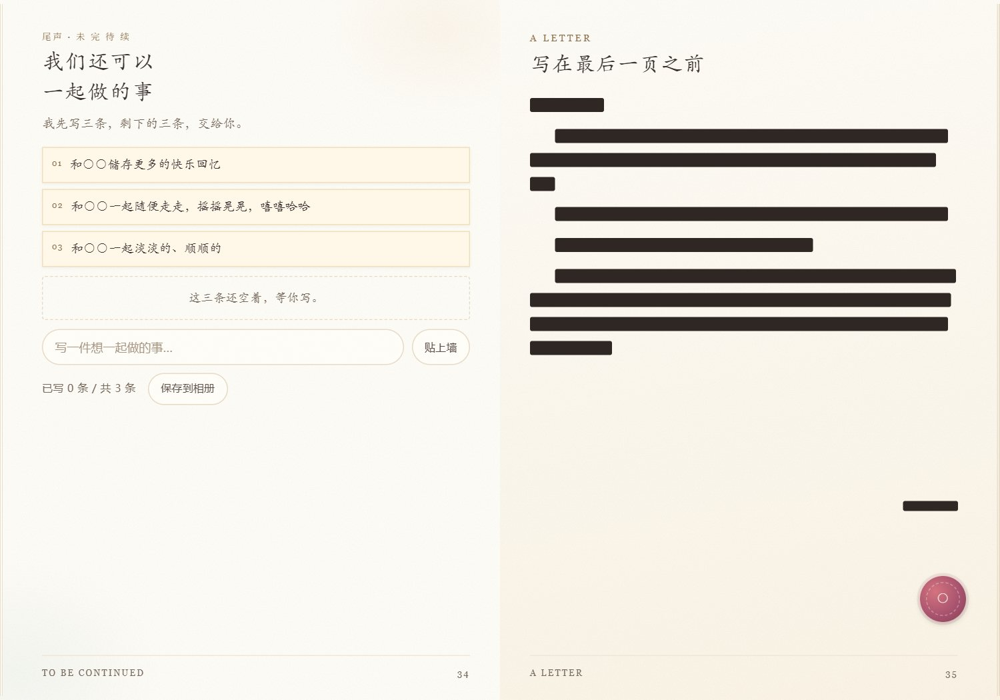

# 拾光手账 · Paper Memory

> 一本可以真的翻开、翻牌、贴纸的网页手账书。37 页，纯静态，零构建，零后端。

**[→ 打开这本书](https://amelia-bu.github.io/shiguang-magic-book/)**


---

## 这是什么

把一段日子的照片、便签、票根和手写批注，装订成一本能在浏览器里翻的书：硬壳封面、环衬、目录、书签带、页码一应俱全，翻页有纸张的弧度和轻响。里面还藏了三个小游戏和一间贴纸工坊。

它为一个人做过一次——所以书里有一封写给「○○」的信。代码是通用的：换掉 `assets/data.js` 里的照片和文案，就是另一本书。

> 📌 本文所有截图里的照片均已模糊、人名与信件正文已打码，用于公开演示。

---

## 功能

### 一、翻书这件事

| 能力 | 说明 |
| --- | --- |
| 立体翻页 | 基于 StPageFlip，拖动书角、点击页面、按 `←` `→` 都能翻 |
| 双页 / 单页自适应 | 宽屏摊开两页；窄屏（手机）自动切单页，不缩小到看不清 |
| 整版等比缩放 | 每页固定 500×700 的版面，按容器缩放，字号与留白永不走形 |
| 阅读进度 | 自动记住停在第几页，关掉浏览器再回来接着读（`localStorage`） |
| 书签带 + 目录跳转 | 目录按真实页号跳转，点哪页去哪页 |
| 轻音效 | 翻页、翻牌、配对成功都有音，可一键静音 |

### 二、书里有什么

```
封面 → 环衬 → 目录 → 序章 → 第一印象 → 记忆配对
     → 第一章 → 记忆 1…20 → 魔法抽卡 → 生日邀请
     → 生日快乐 → 猜猜礼物 → 日历 → 插页袋
     → 尾声 → 那封信 → 藏书票 → 封底
```

- **记忆页**：单图、双图、视频三种版式自动切换；照片带胶带、倾斜角、手写日期
- **日历页**：一份可以点开看每一天的月历
- **藏书票**：EX LIBRIS，记录一起走过的天数
- **插页袋**：收着自己在工坊做的页，最新的一页压在最上面


记忆页：照片带胶带和手写日期，视频页可以直接点开播放（照片已打码）：


### 三、三个可以玩的小机关

| 小游戏 | 玩法 |
| --- | --- |
| **六对底片** | 12 张牌打乱，翻开两张，同一天就配对成功——六对，慢慢来 |
| **魔法抽卡** | 24 张牌里抽一张，抽到哪张就翻到那一天 |
| **猜猜礼物** | 三个包好的盒子，掀开一个看看；猜错的两个也一起送你 |

左侧是「六对底片」，右侧是第一章的扉页：


抽卡与生日邀请同框——书翻到这一页时，蜡烛已经插好了：


日历与插页袋：


### 四、那封信

全书唯一不能糊弄的一页。信纸、手写体、落款、火漆印都在，正文这里已经打码：



> 打码是截图处理，书里的原文完好无损。

### 五、两个工具箱

- **贴纸工坊**：90 枚贴纸随手拖，便签随手写，拼完装订成插页，直接进到书的第 33 页
- **记忆图鉴**：把 24 张贴画、15 张记忆卡按日期摊开看，可以翻页、可以抽卡

### 六、手机上也好看

窄屏自动换成单页模式，标题、贴纸、铜扣都按比例重排：


---

## 技术实现

没有框架、没有打包、没有服务端。`index.html` 直接双击就能跑（本地用服务器更稳）。

| 关注点 | 做法 |
| --- | --- |
| 翻页引擎 | [StPageFlip](vendor/page-flip.browser.js) 本地引入，`size: stretch` + `usePortrait` |
| 版式稳定 | `.pg` 固定 500×700，外层 `.pg-fit` 用 `scale(纸宽 / 500)` 整体缩放 |
| 内容来源 | `assets/data.js` 一份数据，照片、日期、卡面文案都从里面长出来 |
| 状态保存 | 阅读进度、贴纸、插页、抽到的卡都在 `localStorage`；存储被禁用时降级为内存 |
| 插画 | 礼盒、蛋糕、卡片、羊年日历全部是 CSS 与内联 SVG，没有一个位图 |
| 体积 | 164 张 webp + 6 段 mp4，共约 26 MB；首屏只加载需要的部分 |

---

## 目录结构

```
.
├── index.html          入口：首页、图鉴、工坊、书
├── app.js              页面切换、铜扣密码、贴纸工坊、图鉴
├── book.js             37 页的生成与翻页、三个小游戏的逻辑
├── styles.css          首页与工具箱样式
├── book.css            书页版式、插页、贴纸
├── vendor/
│   └── page-flip.browser.js
├── assets/
│   ├── data.js         内容数据（照片、日期、卡面）
│   ├── memory/         记忆页照片
│   ├── cards/          24 张魔法卡
│   ├── stickers/       90 枚贴纸
│   ├── match/          配对游戏的牌面
│   └── film/           6 段视频
└── docs/shots/         README 截图（已打码）
```

---

## 本地运行

浏览器的安全策略不允许 `file://` 下读取部分资源，起一个静态服务器最省事：

```bash
python3 -m http.server 8080
# 然后打开 http://localhost:8080
```

书扣的密码写在 `app.js` 的 `PASSWORD` 常量里，想改成自己的，改这一行即可。

---

## 关于这本书的隐私

书里的照片和人只属于一个人。所以：

- 这一版的 `.gitignore` 之外的每一张照片都经过了**模糊处理**才放进文档
- 人名、信件正文、寄信人署名在截图中已打码
- 页面加了 `noindex` 与 `robots.txt`，搜索引擎不会收录

想在别处复刻这个结构：**代码随便看，内容请别搬。**

---

## 致敬

写给一个人，也给所有被风翻过的日子。
